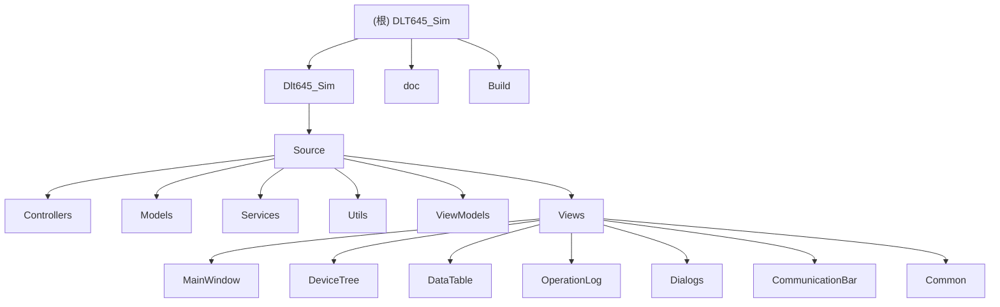

# DLT645_Sim - DLT645-2007 多功能电能表模拟器

> 更新时间：2026-07-13

## 项目愿景

DLT645_Sim 是一个基于 Qt5 Widgets 的工业级 DLT645-2007 协议电能表模拟器桌面应用，采用 MVVM 架构实现界面与业务逻辑完全解耦。系统完整实现协议规范中七类数据项的电能表功能模拟，支持通过 RS485 串口或 TCP 网络与网关或主站系统进行通信，用于测试、调试及教学演示。

**核心价值**：
- 为电力自动化系统开发者提供全功能电表测试环境
- 支持多实例并行运行，模拟大规模电表部署场景
- 提供完整的协议报文监视与日志记录能力
- 实现工业级深色主题，适合长时间专业使用

## 架构总览

### 技术栈

| 组件 | 技术选型 | 版本 |
|------|---------|------|
| 开发框架 | Qt | 5.14.2+ |
| 编程语言 | C++ | C++17 |
| 构建系统 | qmake | - |
| UI 设计 | Qt Widgets + .ui 文件 | - |
| 串口通信 | Qt SerialPort | - |
| 网络通信 | Qt Network (QTcpSocket) | - |
| 数据库 | Qt SQL | - |
| 数据格式 | JSON 配置 | - |
| 图标系统 | SVG 矢量图标（Qt Resource 内嵌） | - |
| 主题 | UiTheme 全局调色板（设计 token） | - |

### 分层架构

```
┌─────────────────────────────────────────────────────────────┐
│                       Qt Widgets UI                          │
│  MainWindow / DeviceTreeWidget / DataTableWidget / Dialogs  │
└─────────────────────────────────────────────────────────────┘
                            ↕
┌─────────────────────────────────────────────────────────────┐
│                    ViewModel / UI协调层                       │
│                  MainWindowViewModel                         │
└─────────────────────────────────────────────────────────────┘
                            ↕
┌─────────────────────────────────────────────────────────────┐
│                Controller / Service层                        │
│  ConnectionManager / ProtocolController / ProtocolParser    │
│  SerialController / TcpController / MasterQueryController    │
│  DataGenerator / TermCatalogService                         │
└─────────────────────────────────────────────────────────────┘
                            ↕
┌─────────────────────────────────────────────────────────────┐
│                     Domain Model层                           │
│   MeterModel / DataItem / ConnectionConfig / MeterInfo      │
│   TermDefinition / CategoryCatalog                          │
└─────────────────────────────────────────────────────────────┘
                            ↕
┌─────────────────────────────────────────────────────────────┐
│                   协议与基础工具层                            │
│  BCDHelper / ChecksumHelper / DLT645DataHelper / Logger     │
│  DLT645FrameFormatter / DLT645BlockHandler / DLT645ValueFormatter │
│  UiTheme（全局调色板/设计token） / ConnectionInfoMapper      │
└─────────────────────────────────────────────────────────────┘
```

## 模块结构图



## 模块索引

| 模块路径 | 职责描述 | 关键文件 |
|---------|---------|---------|
| [`Dlt645_Sim/Source/Controllers/`](./Dlt645_Sim/Source/Controllers/) | 通信与协议控制 | SerialController, TcpController, ProtocolController, ConnectionManager, MasterQueryController |
| [`Dlt645_Sim/Source/Models/`](./Dlt645_Sim/Source/Models/) | 电表领域模型 | MeterModel（拆分为 MeterModelPrivate* 多文件）, DataItem, ConnectionConfig, ConnectionInfo, ConnectionInfoMapper, MeterInfo, CategoryCatalog, MeterPhaseType, TermDefinition |
| [`Dlt645_Sim/Source/Services/`](./Dlt645_Sim/Source/Services/) | 协议与数据服务 | ProtocolParser, DataGenerator, MeterDataStore, ConfigurationSerializer, TermCatalogService |
| [`Dlt645_Sim/Source/Utils/`](./Dlt645_Sim/Source/Utils/) | 基础工具类 | BCDHelper, ChecksumHelper, DLT645DataHelper, Logger（+LoggerTypes）, DLT645FrameFormatter（+Fields/ValueDisplay 头）, DLT645BlockHandler, DLT645ValueFormatter, UiTheme（全局调色板/设计 token） |
| [`Dlt645_Sim/Source/ViewModels/`](./Dlt645_Sim/Source/ViewModels/) | 视图模型 | MainWindowViewModel |
| [`Dlt645_Sim/Source/Views/`](./Dlt645_Sim/Source/Views/) | UI界面组件 | MainWindow（拆分为 mainwindow_* 多文件）, DeviceTreeWidget, DataTableWidget, OperationLogWidget, CommunicationBarWidget, Common（FrameParseResultWidget/TermExplanationWidget）, Dialogs |

## 运行与开发

### 构建要求

- **操作系统**：Windows 10/11, Linux (Ubuntu 20.04+)
- **Qt 版本**：Qt 5.14.2+ (推荐 Qt 5.15.x)
- **编译器**：
  - Windows: MSVC 2019+ 或 MinGW 8.1+
  - Linux: GCC 7+ 或 Clang 10+
- **构建工具**：qmake

### 构建步骤

```bash
# 1. 克隆项目
git clone https://github.com/LIEVEZ/DLT645_Sim.git
cd DLT645_Sim

# 2. 生成 Makefile（Shadow Build 推荐）
mkdir Build
cd Build
qmake ../Dlt645_Sim/Dlt645_Sim.pro

# 3. 编译（Windows MinGW）
mingw32-make -j4

# 3. 编译（Linux）
make -j4

# 4. 运行
./debug/Dlt645_Sim  # Linux / MinGW
# 或双击 debug/Dlt645_Sim.exe（Windows）
```

### 配置文件

- **项目配置**：`Build/dlt645_config.json` - 连接和电表配置持久化
- **日志文件**：`%APPDATA%/dlt645_sim.log` (Windows) / `~/.local/share/dlt645_sim.log` (Linux)
- **日志设置**：10MB/文件，保留 5 个备份，默认 Info 级别

### 开发工具

- **推荐 IDE**：Qt Creator 5.0+
- **代码格式化**：`.clang-format` (项目根目录)
- **文档生成**：Doxygen
- **版本管理**：Git

## 测试策略

### 当前测试状态

项目当前以手动测试为主，重点关注：
- 串口/TCP 连接稳定性
- 协议帧解析正确性
- 数据模型线程安全
- UI 响应流畅度

### 测试建议

**单元测试**（计划中）：
- 工具类：BCDHelper, ChecksumHelper, DLT645DataHelper
- 协议解析：ProtocolParser 的帧解析与组装
- 数据模型：MeterModel 的数据访问与并发安全

**集成测试**（计划中）：
- 串口/TCP 通信流程
- 协议收发流程
- 数据持久化流程

**性能测试**：
- 1000 行数据表格滚动流畅（≥30fps）
- 1Hz 刷新率下 CPU 占用 < 5%
- 24 小时运行无内存泄漏

## 编码规范

### C++ 规范

- 使用 C++17 标准特性
- 遵循 Qt Coding Style
- 类名：大驼峰（PascalCase）
- 函数/变量：小驼峰（camelCase）
- 私有成员：`m_` 前缀
- 常量：`k` 前缀或全大写
- 一行最大 120 字符
- 使用 Qt 容器类（QList, QMap, QString）

### 架构原则

- 视图层不直接持有业务逻辑
- 模型层通过信号通知视图更新
- 控制器负责协调模型与通信
- 工具类保持无状态、可复用
- 使用 QMutex 保护共享数据
- 优先使用智能指针管理资源

### 注释规范

- 使用 Doxygen 风格注释
- 公开 API 必须有 `@brief` 说明
- 复杂逻辑必须有行内注释
- 文件头包含版权和用途说明

## AI 使用指引

### 快速定位

1. **协议相关**：从 `ProtocolParser.h` 和 `ProtocolController.h` 入手
2. **数据模型**：核心在 `MeterModel.h` 和 `DataItem.h`（实现按职责拆分到 `MeterModelPrivate*.h` 与 `MeterModelInitialization*.cpp`）
3. **通信层**：`SerialController.h` / `TcpController.h` / `ConnectionManager.h`
4. **主站查询**：`MasterQueryController.h`（独立串口主站，主动向外发查询帧）
5. **UI 框架**：`mainwindow.h` 是装配中心（实现拆分为 `mainwindow_*.cpp`）
6. **术语解释**：`TermCatalogService.h` + `TermDefinition.h` + `TermExplanationWidget.h`
7. **报文解析展示**：`DLT645FrameFormatter.h` + `FrameParseResultWidget.h` + `FrameParseDialog.h`
8. **主题与配色**：`UiTheme.h`（全局调色板 / 设计 token，改色的唯一入口）
9. **图标资源**：`resources.qrc` + `Resources/Icons/*.svg`（SVG 矢量图标）
10. **工具类**：`Utils/` 目录下各类独立工具

### 核心概念

- **MeterModel**：电表核心模型，管理所有数据项（DataItem）和电表参数；实现按初始化/费率/冻结/同步/随机化等职责拆分为多个 Private 头文件与初始化源文件
- **MeterPhaseType**：电表相别类型（单相表/三相表），单相表隔离不适用的事件记录与数据项
- **DataCategory**：七类数据分类（电能量/最大需量/变量/事件/参变量/冻结/负荷记录）
- **ProtocolFrame**：DLT645-2007 协议帧结构体
- **ControlCode**：控制码枚举（读数据 0x11、写数据 0x14 等）
- **ConnectionConfig / ConnectionInfo**：连接配置与运行态信息（串口/TCP 参数）；`ConnectionInfoMapper` 负责由配置生成运行态信息
- **UiTheme**：全局 UI 调色板（设计 token），统一管理主窗口与各对话框/控件的配色（海军蓝/钢青蓝主题），改色只需修改 `UiTheme.cpp` 的 darkPalette()/lightPalette()
- **MasterQueryController**：主站查询控制器，独立串口模拟主站主动发起查询
- **TermCatalogService**：术语目录服务（单例），加载与检索电表术语库供术语解释功能使用
- **UiTheme**：全局 UI 调色板（设计 token），统一主窗口与各对话框/控件的配色，消除散落各文件的硬编码颜色；当前采用工业「钢青蓝 / 海军蓝」主题，改色只需修改 `darkPalette()` / `lightPalette()`
- **ConnectionInfoMapper**：将 `ConnectionConfig` 映射为运行态 `ConnectionInfo`（含连接状态）的无状态转换器
- **DLT645FrameFormatter**：报文格式化器，将原始帧解析为分区分卡片的可视化结果（FrameParseDisplayResult）

### 关键数据流

```
用户操作 → MainWindow → ViewModel → Controller 
    ↓                                   ↓
DeviceTree ← Model ← ProtocolParser ← SerialController/TcpController
    ↓                                   ↓
DataTable ← MeterModel ← DataGenerator  ← 外部主站/网关
```

### 常见任务入口

- **新增数据项**：修改 `MeterModelInitialization*.cpp`（按数据类分文件）和 `CategoryCatalog`
- **修改协议行为**：调整 `ProtocolParser` 和 `ProtocolController`
- **修改主站查询行为**：调整 `MasterQueryController` 和 `MasterQueryDialog`
- **修改报文解析展示**：调整 `DLT645FrameFormatter` 系列与 `FrameParseResultWidget`
- **维护术语库**：通过 `TermCatalogService` 加载/检索，UI 在 `TermExplanationWidget`
- **增加 UI 组件**：在 `Views/` 目录创建新组件，通过 `mainwindow_setup.cpp` 装配
- **调整主题配色**：修改 `Utils/UiTheme.cpp` 的 darkPalette()/lightPalette()，全应用自动同步
- **新增/替换图标**：在 `Resources/Icons/` 放置 SVG，并在 `resources.qrc` 注册
- **增加工具函数**：在 `Utils/` 目录添加独立工具类

### DLT645-2007 协议要点

- **帧格式**：FE FE FE FE | 68 | A0-A5 (6字节地址) | 68 | C (控制码) | L (数据长度) | DATA | CS | 16
- **地址域**：6 字节 BCD 码，低位在前（A0 A1 A2 A3 A4 A5）
- **控制码**：读数据 0x11，写数据 0x14，读地址 0x13 等
- **数据域**：需要 +33H 偏移（发送时），接收时需要 -33H 还原
- **校验和**：从第一个 68H 到校验和前一字节的模 256 累加和
- **DI 编码**：4 字节数据标识，如 00 00 00 00（组合有功总电能）

## 变更记录

### [2026-07-13] - UI 主题重构与图标系统扫描
- 重新扫描项目结构，识别 58 个头文件、61 个源文件
- 新增 `Utils/UiTheme`：全局调色板（设计 token），消除原先散落在 8 个文件、300+ 处的硬编码颜色；深色主题改为工业「海军蓝 / 钢青蓝」配色，改色只需修改 darkPalette()/lightPalette()
- 集成 SVG 矢量图标系统：`resources.qrc` + `Resources/Icons/*.svg`（27 个图标，Qt Resource 内嵌）
- 新增 `Models/ConnectionInfoMapper`：ConnectionConfig → ConnectionInfo 映射工具
- 新增 `Source/Version.h`（软件版本 V1.0.0）、`Utils/LoggerTypes.h`、`DLT645FrameFormatterFields.h`、`DLT645FrameFormatterValueDisplay.h`
- 对话框布局与全局字体优化，增加空数据状态展示（empty-data 图标）
- 解决主站查询串口号排序问题、费率相关问题
- 预留空目录：`Models/DataIdentifier`、`Views/StatusBar`、`Views/ToolBar`

### [2026-06-26] - 功能扩展与架构细化扫描
- 重新扫描项目结构，识别 57 个头文件、60 个源文件
- MainWindow 拆分为多文件实现（theme/setup/dialogs/configuration/connections/meters/protocol/status/helpers）
- MeterModel 初始化逻辑按数据类拆分（Energy/Variable/Event/Parameter/Freeze 等多文件）
- 新增主站查询功能（MasterQueryController / MasterQueryDialog）
- 新增术语解释功能（TermCatalogService / TermDefinition / TermExplanationWidget）
- 新增报文解析展示功能（FrameParseDialog / FrameParseResultWidget / DLT645FrameFormatter 系列）
- 新增单相表支持（MeterPhaseType）与事件记录隔离（EventRecordDialog）
- Utils 新增帧格式化器系列：DLT645FrameFormatter, DLT645BlockHandler, DLT645ValueFormatter

### [2026-06-17] - 项目初始化扫描
- 完成项目架构扫描与文档生成
- 识别 52 个头文件，57 个源文件
- 确认 MVVM 架构分层清晰
- 模块结构图与面包屑导航建立

### [2026-03-24] - v1.0.0 版本发布
- 完成基础 UI 框架与深色主题
- 实现串口/TCP 双模式通信
- 完成电能量、变量数据类完整支持
- 实现数据表格编辑、随机化、导出
- 完成操作日志记录与过滤
- 完成配置持久化

---

## 许可证

MIT License - Copyright (c) 2026 LIEVEZ

---

**维护者**：LIEVEZ  
**项目地址**：https://github.com/LIEVEZ/DLT645_Sim  
**文档版本**：v1.2  
**状态**：✅ 生产就绪
