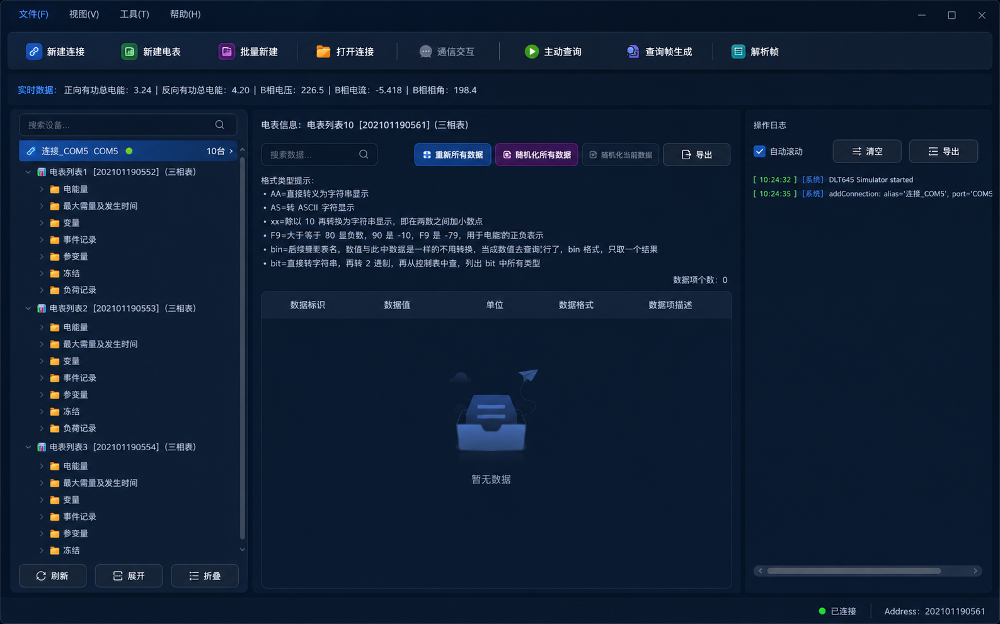

# DLT645_Sim - DLT645-2007 多功能电能表模拟器

<div align="center">


[](https://github.com/LIEVEZ/DLT645_Sim/actions/workflows/build.yml)

一个基于 Qt5 Widgets 的 DL/T 645-2007 多功能电能表模拟器<br>
A Qt5-based DL/T 645-2007 electricity meter simulator for testing and teaching.

[功能特性](#功能特性) • [协议范围](#协议支持范围) • [快速开始](#快速开始) • [使用说明](#使用说明) • [测试](#测试) • [已知限制](#已知限制与路线图) • [免责声明](#免责声明)

</div>



## 项目简介

DLT645_Sim 是一个桌面端软件电能表模拟器，按 DL/T 645-2007 协议对七类数据项建模，可通过 RS485 串口或 TCP 与主站、网关、采集终端交互，用于电力自动化开发、协议联调、教学演示和测试。

- **多连接、多电表**：一个进程内可同时管理多条连接和多块虚拟电表
- **自动应答**：收到读/写等请求后按配置的电表数据生成 645 应答帧
- **调试友好**：收发报文监视、帧解析、查询帧生成、独立主站查询工具
- **纯软件模拟**：不需要真实电表硬件，适合实验室和桌面测试

> 本项目是协议模拟器，不采集真实电量，也不控制真实电表。请勿用于生产计费、真实电网控制或任何安全关键场景，详见[免责声明](#免责声明)。

## 功能特性

### 电表与数据

- 七类数据项建模：电能量、最大需量及发生时间、变量、事件记录、参变量、冻结、负荷记录
- 单相表 / 三相表切换；单相表自动过滤 B/C 相数据项
- 事件记录总开关与分类开关
- 费率数、结算日、时区时段等参数配置
- 数据手工编辑、随机化、重置、CSV / JSON 导出
- 支持 DI 数据块读取（如电压/电流/功率数据块、谐波、冻结数据块）

### 通信

- RS485 串口：波特率、数据位、校验位、停止位、流控可配置
- TCP：作为**客户端**连接主站/网关所在的服务端（本程序不监听端口）
- 自动应答读数据（0x11）、读通信地址（0x13）、写数据（0x14）、写通信地址（0x15）、远程控制（0x1C）
- 写数据/远程控制校验权限码、密码和操作者代码
- 厂商扩展：认证状态读写（0x2A / 0x2F）

### 调试与工具

- 通信交互窗口：实时显示收发原始报文
- 帧解析：粘贴 HEX 报文查看分字段解析结果
- 查询帧生成器：按 DI 生成读/写请求帧
- 主站查询：使用独立串口模拟主站，支持读数据、写数据、远程控制、原始 HEX 发送、广播读通信地址
- 电表密码 / 认证报文生成工具
- 操作日志、错误提示与日志文件

### 界面

- 深色 / 浅色主题（`UiTheme` 统一配色）
- 设备树导航、数据表格搜索与过滤
- 多实例运行

## 协议支持范围

### 已支持的控制码

| 控制码 | 功能 | 状态 |
|--------|------|------|
| 0x11 | 读数据 | ✅ |
| 0x13 | 读通信地址 | ✅ |
| 0x14 | 写数据（校验权限码/密码/操作者代码） | ✅ |
| 0x15 | 写通信地址 | ✅ |
| 0x1C | 远程控制（跳闸、合闸、直接合闸、报警、报警解除、保电、保电解除） | ✅ |
| 0x2A / 0x2F | 认证状态读写（厂商扩展） | ✅ |

### 暂未实现的控制码

| 控制码 | 功能 |
|--------|------|
| 0x08 | 广播校时 |
| 0x12 | 读后续数据（多帧大数据块） |
| 0x16 | 冻结命令 |
| 0x17 | 更改通信速率 |
| 0x18 | 修改密码 |
| 0x19 | 最大需量清零 |
| 0x1A | 电表清零 |
| 0x1B | 事件清零 |

> 单帧应答的数据域受 1 字节长度域限制（最大 255 字节）。需要多帧传输的负荷记录等场景请等待后续版本或自行扩展。

数据域 +33H / -33H 偏移、BCD 编码、模 256 校验和等基础规则已按标准实现；实现位置见 `Source/Utils/DLT645DataHelper.*`、`Source/Services/ProtocolParser.*`。

## 快速开始

### 系统要求

- 操作系统：Windows 10/11 或 Linux（Ubuntu 20.04+）
- Qt：5.14.2+（推荐 5.15.x），需要 `widgets`、`serialport`、`network`、`sql` 模块
- 编译器：MSVC 2019+ / MinGW 8.1+（Windows），GCC 7+ / Clang 10+（Linux）
- 构建工具：qmake + make / mingw32-make / nmake

### 获取源码

```bash
git clone https://github.com/LIEVEZ/DLT645_Sim.git
cd DLT645_Sim
```

### 构建

**Linux**

```bash
sudo apt-get update
sudo apt-get install -y build-essential qtbase5-dev qtbase5-dev-tools \
    libqt5serialport5-dev qt5-qmake

mkdir -p Build && cd Build
qmake ../Dlt645_Sim/Dlt645_Sim.pro
make -j"$(nproc)"
```

**Windows（Qt Creator）**

1. 打开 Qt Creator，加载 `Dlt645_Sim/Dlt645_Sim.pro`
2. 选择 Qt 5.14.2+ 的 Kit（MinGW 或 MSVC）
3. 点击“构建”，再点击“运行”

**Windows（命令行，MinGW）**

```bat
mkdir Build
cd Build
qmake ..\Dlt645_Sim\Dlt645_Sim.pro
mingw32-make -j4
```

产物位于构建目录下的 `debug/` 或 `release/` 子目录（取决于构建配置）。

### 运行

```bash
# Linux
./Build/release/Dlt645_Sim

# Windows MinGW
Build\release\Dlt645_Sim.exe
```

也可以直接在 Qt Creator 中运行。

### 打包 Windows 可执行文件

在 Qt 命令行环境中，对生成的可执行文件运行 `windeployqt`：

```bat
windeployqt --release --no-translations Build\release\Dlt645_Sim.exe
```

然后把可执行文件所在目录整体压缩分发。发布二进制时请同时遵守 Qt 的 LGPLv3 许可要求（见[许可证](#许可证)）。

## 使用说明

### 1. 新建连接

点击工具栏“新建连接”：

- **串口**：选择串口号、波特率（默认 2400）、数据位、校验位、停止位
- **TCP**：填写服务端 IP 地址和端口号。本程序作为客户端主动连接该服务端

### 2. 新建电表

在设备树中右键连接节点，选择“新建电表”（也支持批量新建）：

- 电表别名
- 通信地址（12 位十进制数字，按 BCD 低位在前编码）
- 操作者代码（8 位数字，默认 `00000000`）
- 电表密码 / 凭据（8 位数字，默认 `00000002`）
- 单相表 / 三相表
- 是否包含前导 FE
- 是否存在事件记录

### 3. 打开连接并查看数据

右键连接节点选择“打开连接”，然后选择电表节点，在数据表格中查看或编辑数据。数据表格支持搜索、随机化、重置和导出（CSV / JSON）。

### 4. 报文与调试工具

- **通信交互窗口**：实时查看收发报文，双击可查看解析结果
- **帧解析**：粘贴 HEX 报文查看起始符、地址、控制码、数据域、校验和等字段
- **查询帧生成器**：按数据标识生成读/写请求帧
- **主站查询**：使用独立串口模拟主站，支持读数据、写数据、远程控制、原始 HEX 发送和广播读地址

### 5. 配置导入 / 导出

通过“文件”菜单可以将连接和电表配置导出为 JSON（建议文件名 `dlt645_config.json`），下次使用时再导入。

> 当前版本**不会自动保存或自动加载**配置，退出前请手动导出；如需自动持久化，请关注后续版本。

### 默认凭据说明

新建电表的默认凭据为 `00000002`，其含义是：

- 前 6 位 `000000`：密码
- 后 2 位 `02`：权限码（PA）

写数据和远程控制请求会同时校验密码、权限码和操作者代码。默认凭据仅用于本地演示，接入任何共享或外部系统前请修改。

### 数据格式串

数据项使用逗号分隔的格式串描述字节布局，常用 token 包括 `AA`、`xx`、`F9`、`PF` 和小数点 `.`。新增数据项时请参考现有初始化代码和 `BCDHelper` / `DLT645DataHelper` 的实现，确保每个字节对应一个逗号分组。

## 测试

仓库包含两个 QtTest 工程：

| 测试 | 覆盖内容 |
|------|----------|
| `Dlt645_Sim/tests/ProtocolControllerTest` | 写数据/远程控制凭据校验、地址写入与路由 |
| `Dlt645_Sim/tests/PowerFactorFormatTest` | 功率因数格式编解码 |

使用 qmake 单独构建并运行，例如：

```bash
mkdir -p Build/tests-pf && cd Build/tests-pf
qmake ../../Dlt645_Sim/tests/PowerFactorFormatTest/PowerFactorFormatTest.pro
make -j"$(nproc)"
./PowerFactorFormatTest
```

Windows 下把 `make` 换成 `mingw32-make`，可执行文件通常位于 `release/` 子目录。CI 会同时构建主程序和测试，见 [`.github/workflows/build.yml`](.github/workflows/build.yml)。

## 项目结构

```text
DLT645_Sim/
├── Dlt645_Sim/
│   ├── Dlt645_Sim.pro          # qmake 工程
│   ├── resources.qrc           # SVG 图标与资源配置
│   ├── Source/
│   │   ├── Assets/             # 图标、术语表
│   │   ├── Controllers/        # 串口/TCP/协议/主站查询控制器
│   │   ├── Models/             # MeterModel、DataItem、分类目录
│   │   ├── Services/           # 协议解析、配置序列化
│   │   ├── Utils/              # BCD、校验和、报文格式化、日志、主题
│   │   ├── ViewModels/         # 主窗口视图模型
│   │   ├── Views/              # 主窗口、设备树、数据表格、对话框
│   │   └── main.cpp
│   └── tests/                  # QtTest 测试工程
├── doc/                        # 协议笔记与费率说明
├── docs/images/                # README 截图
├── .github/workflows/          # CI
├── LICENSE
└── README.md
```

## 开发与贡献

- 语言标准：C++17，遵循 Qt 编码风格；成员变量使用 `m_` 前缀
- 新增 `.cpp` / `.h` 后需要手动加入 `Dlt645_Sim.pro`
- 协议层改动请注意：数据域 ±33H 偏移、BCD 低位在前、校验和范围、DI 4 字节编码
- 修改型号/格式相关逻辑时请补充或更新 `tests/` 下的测试
- 提交前请至少完成一次完整构建；CI 会检查 Linux 构建和测试

更详细的贡献流程见 [CONTRIBUTING.md](CONTRIBUTING.md)。

## 已知限制与路线图

**已知限制**

- 暂未接入实时数据自动变化（`DataGenerator` 为预留代码），数据只会在手工编辑、随机化、重置或收到写命令时改变
- 配置不会自动保存/加载，需要手动导入/导出 JSON
- SQLite 数据存储（`MeterDataStore`）尚未接入
- TCP 仅支持客户端模式，不支持监听端口作为服务端
- 未实现 0x08 / 0x12 / 0x16 / 0x17 / 0x18 / 0x19 / 0x1A / 0x1B 等控制码
- 单帧数据域受 255 字节长度限制，不支持 0x12 多帧续读
- 主站查询写数据时，输入的数字串需与目标 DI 格式所需字节数匹配，当前不会自动补位
- 部分事件记录、参数项使用演示默认值，不代表完整的一致性测试结果

**路线图**

- [ ] 接入实时数据生成（电压/电流/功率波动、电能累加）
- [ ] 自动配置持久化与 SQLite 存储
- [ ] 广播校时、冻结、清零等控制码
- [ ] 多帧读后续数据（0x12）
- [ ] TCP 服务端模式
- [ ] 更完整的自动化测试与协议一致性用例

欢迎通过 Issue 或 Pull Request 参与改进。

## 免责声明

- 本项目为**纯软件模拟器**，仅用于开发、测试、教学和协议联调，**不得用于真实电能计量、电费结算、电网控制或其他安全关键场景**。
- 软件按“现状”提供，不保证与标准或真实电表完全一致；使用前请对照标准原文和实际设备自行验证。
- 默认密码、权限码、操作者代码均为演示数据，请在连接到共享环境或外部系统前修改。
- TCP 模式没有认证和加密机制，请勿将监听端口或连接暴露到公网。
- 因使用本软件造成的任何直接或间接损失，作者不承担责任。

## 许可证

本项目采用 MIT License，详见 [LICENSE](LICENSE)。

第三方组件：

- **Qt 5**：以 LGPLv3 许可发布。发布包含 Qt 库的二进制包时，请遵守 LGPLv3 的相应要求（动态链接、提供许可证声明、允许替换库文件等）。
- 仓库中的 SVG 图标与术语表随项目一同发布；如你认为其中包含未标注的第三方素材，请提交 Issue 以便处理。
- DL/T 645-2007 标准原文受版权保护，**不随本仓库分发**；请通过正规渠道获取。

## 贡献与联系

- 提交 Issue：<https://github.com/LIEVEZ/DLT645_Sim/issues>
- 提交 Pull Request：请先阅读 [CONTRIBUTING.md](CONTRIBUTING.md)
- 作者：LIEVEZ

---

<div align="center">

**如果这个项目对你有帮助，欢迎点一个 Star ⭐**

Made with ❤️ by LIEVEZ

</div>
